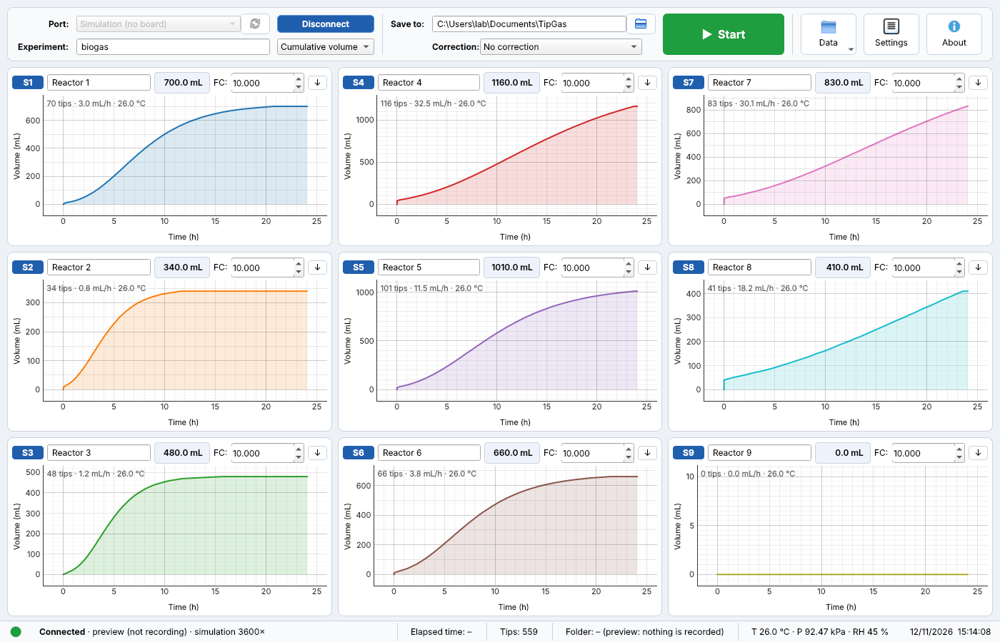
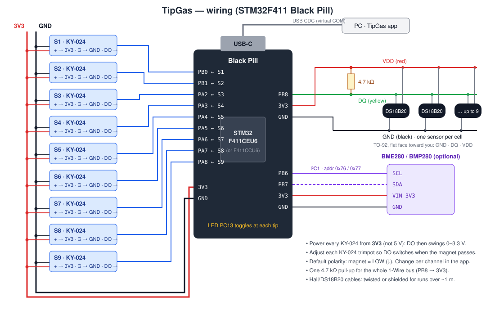
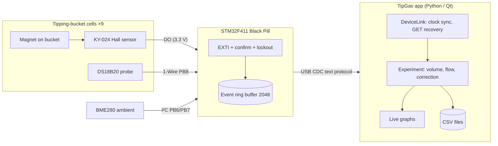

# TipGas

**Open-source 9-channel tipping-bucket gas meter for low gas flows** — biogas, fermentation, respirometry and any reaction that releases gas slowly (from a few mL/h up to a few L/h per cell).

Each cell is a tipping-bucket counter: gas fills a small inverted bucket under liquid until it tips and releases a fixed volume. A Hall sensor and a magnet detect every tip. An **STM32F411 "Black Pill"** timestamps the tips of up to nine cells, and the **TipGas desktop app** turns them into cumulative volume and flow, corrected for temperature and pressure.



## Features

- **9 independent channels** on one USB cable; KY-024 (or any digital Hall) sensors at 3.3 V, per-channel polarity.
- **Robust counting in firmware**: edge interrupt + 3 ms level confirmation + configurable lockout (default 2 s) against noise and mechanical bounce; 1 ms timestamps from a 64-bit clock.
- **No lost tips**: the board keeps the last 2048 events numbered; if the PC sleeps, the cable is unplugged or the app is closed, missing events are fetched back on reconnection.
- **Temperature at every tip**: optional DS18B20 probes (one per cell, single 1-Wire bus) and an optional BME280/BMP280 for ambient T, P, RH.
- **Volume correction** to calibration conditions (method of the reference article, with water vapour by the Antoine equation) or to STP dry/wet gas.
- **Calibration assistant** for the volume per tip of each cell (k = V / n, with counting uncertainty).
- 3×3 live graphs (cumulative volume or flow) with pan, zoom and autoscale; event log; simulation mode with no hardware.
- **One CSV per sensor** with just *time* and *volume*, plus full per-tip details for re-processing.
- Interface in **English and Portuguese** (follows the Windows language; selectable in *Settings*).
- **Portable Windows release**: unzip and run, no Python installation needed.

## Quick start

### 1 · Use the app (Windows)

1. Download `TipGas-<version>-windows-portable.zip` from the [latest release](../../releases/latest) and unzip it anywhere (e.g. Desktop or a USB stick).
2. Run `TipGas.exe`. With no board, pick **Simulation (no board)** in the port list and click **Connect** to try it out.

### 2 · Flash the board (once)

Flash `TipGas_F411.hex` (also in the release) over USB using the Black Pill's built-in DFU bootloader — no ST-Link needed. Step-by-step: [docs/flashing.md](docs/flashing.md).

### 3 · Wire the sensors



Full pin table and notes: [docs/hardware.md](docs/hardware.md).

### Running from source (any OS)

```bash
cd interface
pip install -r requirements.txt
python TipGas.py          # add --sim to start in simulation mode
python tests/test_core.py # automated tests (use the simulator)
```

On Windows you can also double-click `interface/run_tipgas.bat` or `run_simulation.bat`; they find Miniconda/Anaconda/Python and install the libraries on first run.

## Documentation

| Document | Contents |
|---|---|
| [docs/hardware.md](docs/hardware.md) | Bill of materials, wiring diagram, pin map, sensor adjustment |
| [docs/flashing.md](docs/flashing.md) | Flashing the firmware over USB (DFU) or ST-Link; building it |
| [docs/firmware.md](docs/firmware.md) | Tip detection, timing, event buffer, USB protocol, settings in flash |
| [docs/interface.md](docs/interface.md) | Methods used by the app: clock mapping, event recovery, volume, flow, temperature per tip, correction, calibration |
| [docs/data-format.md](docs/data-format.md) | Experiment folder, CSV columns, exports, settings file |

## Architecture



## Repository layout

```
firmware/TipGas_F411/   STM32CubeIDE project (.ioc, HAL, USB CDC) + Makefile
interface/              Python app (PySide6 + pyqtgraph), simulator, tests, launchers
docs/                   Documentation and diagrams
packaging/              PyInstaller script for the portable build
.github/workflows/      CI: firmware, tests, Windows portable zip, GitHub release
```

## License

TipGas is released under the [GNU GPL v3](LICENSE). The STM32 HAL/CMSIS/USB middleware under `firmware/TipGas_F411/Drivers` and `Middlewares` keep their original ST/ARM licenses (BSD-3-Clause / Apache-2.0 / ST SLA0044), included in those folders.
