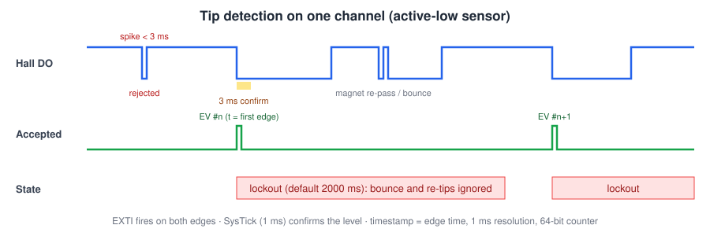
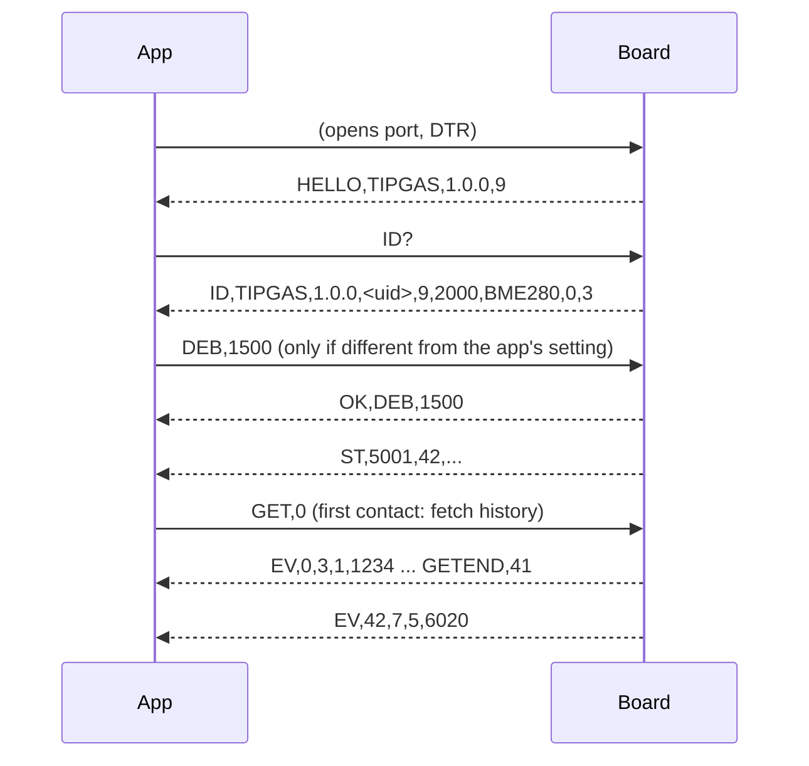

# Firmware

STM32F411 (Black Pill), STM32Cube HAL, USB Device CDC (virtual COM port). Source: `firmware/TipGas_F411/Core/Src/app_flowmeter.c` (application), `ds18b20.c` (1-Wire), `bme280.c` (I²C).

The firmware only **counts and timestamps** tips and reads the sensors. Volumes, calibration factors and corrections are applied in the PC app on the raw data, so they can be changed and recomputed later.

## Tip detection

1. Each Hall input (PB0, PB1, PA2–PA8) has an EXTI interrupt on **both edges**. When a pin goes to its *active* level (LOW by default, per-channel polarity), the interrupt stores a **candidate** with the edge time.
2. The 1 ms SysTick checks candidates: after **3 ms** (`FM_CONFIRM_MS`) the pin must still be at the active level, otherwise the candidate is discarded (noise spike, comparator chatter).
3. A confirmed candidate becomes an **event** timestamped with the *edge* time, unless the channel is inside its **lockout** window (`DEB`, default **2000 ms**, range 20–10000 ms) counted from the previous accepted tip. The lockout swallows mechanical bounce and the magnet passing the sensor twice as the bucket swings.
4. Time comes from a 64-bit millisecond counter (`FM_Millis()`), so it never overflows. Resolution: 1 ms.

Choose the lockout well below the shortest interval between two tips at the highest expected flow, and above the bounce time of your cells. If a cell counts double, increase it.

## Event buffer and recovery

Every event gets a global sequence number `seq` (since boot) and is stored in a ring buffer of **2048 events** (`FM_EVENT_LOG_SIZE`), besides being sent immediately. Every second the board sends `ST` with the next `seq` and the per-channel counts. If the app notices a gap (lost USB line, PC asleep, app closed and reopened), it sends `GET,<seq>` and the board re-sends every buffered event from that number on. Events older than the buffer are reported with `LOST`.

At ~1 tip/min per channel on nine channels the buffer covers about 4 hours of disconnection; the board itself keeps counting indefinitely while powered.

## USB protocol

ASCII text, one message per line ending in `\n`, fields separated by commas. 115200 baud is a formality (USB CDC ignores it).

### Board → PC

| Message | Meaning |
|---|---|
| `HELLO,TIPGAS,<version>,<nch>` | Sent when the port is opened (DTR) |
| `ID,TIPGAS,<version>,<uid>,<nch>,<lockout_ms>,<ambient_sensor>,<pol_mask>,<n_ds18b20>` | Identification and current settings |
| `EV,<seq>,<ch 1..9>,<count_of_channel>,<t_ms>` | A tip |
| `ST,<t_ms>,<next_seq>,<c1>,…,<c9>` | Status, every 1 s |
| `ENV,<t_ms>,<T_C>,<P_Pa>,<RH_%>` | BME280/BMP280, every 5 s (RH = −1 on BMP280) |
| `TMP,<t_ms>,<i>,<rom>,<T_C>` | One DS18B20 reading; `rom` = 16-hex-digit unique code; every 2 s per probe |
| `GETEND,<last_seq_sent>` | End of a `GET` replay |
| `LOST,<seq_requested>,<oldest_available>` | Requested events already overwritten |
| `OK,<command>` / `ERR,<reason>` | Command result |

`t_ms` = milliseconds since the microcontroller booted.

### PC → board

| Command | Effect |
|---|---|
| `ID?` | Identification |
| `ST?` | Immediate status |
| `GET,<seq>` | Re-send all buffered events with number ≥ seq |
| `RST` | Zero the per-channel counts (`seq` keeps increasing) |
| `DEB,<ms>` | Lockout time, 20–10000 ms (saved in flash) |
| `POL,<mask>` | Polarity, 0–511: bit n = 1 → channel n+1 active **HIGH** (saved in flash) |

Example session:

## Settings in flash

Lockout and polarity mask are stored in **flash sector 5** (128 KB at `0x08020000`), with a magic word and a check word. The sector exists on both the F411CE (512 KB) and F411CC (256 KB). It is erased and rewritten only when a value actually changes, so reconnecting does not wear the flash. A new or freshly flashed board starts with 2000 ms and all channels active LOW; the app sends the user's settings on the first connection.

## DS18B20 and BME280

- **1-Wire** on PB8 is bit-banged with microsecond delays from the Cortex-M4 DWT cycle counter. At boot the ROM search algorithm (Maxim AN187) finds up to 9 probes; codes are CRC8-checked.
- Conversions run as a **non-blocking state machine**: start a conversion on all probes (Skip ROM + Convert T), wait 800 ms (750 ms conversion at 12 bits) while the main loop keeps serving tips and USB, then read one probe per loop pass. A complete cycle runs every 2 s (`FM_DS_PERIOD_MS`). Readings with a bad CRC are dropped.
- The **BME280/BMP280** is probed at 0x76 and 0x77 at boot; compensation follows the Bosch datasheet formulas. Read every 5 s.

Tip detection runs in interrupts and SysTick, so sensor reads never delay or hide a tip.
