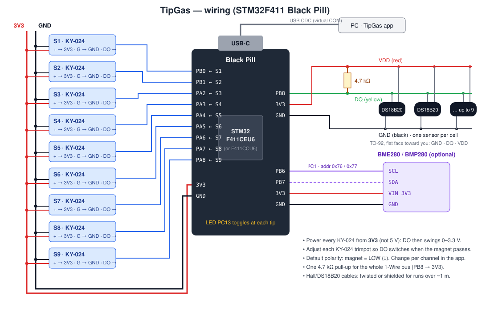

# Hardware

## Bill of materials

| Qty | Part | Notes |
|---|---|---|
| 1 | **WeAct Black Pill STM32F411CEU6** (CCU6 also works) | USB-C, 25 MHz crystal. Firmware uses < 30 KB of flash. |
| 9 | **KY-024** linear Hall module (or any digital Hall switch / A3144 / reed with pull-up) | Use the digital output **DO**. One per cell. |
| 9 | Small neodymium magnet | Glued to the tipping bucket so it passes in front of the sensor at each tip. |
| 0–9 | **DS18B20** waterproof probe (optional) | Gas temperature per cell, read at every tip. |
| 1 | 4.7 kΩ resistor | Pull-up for the 1-Wire bus (only if DS18B20 are used). |
| 0–1 | **BME280** (or BMP280) breakout, 3.3 V (optional) | Ambient T, P (and RH). Needed for STP correction. |
| 1 | USB-C data cable | Power + communication with the PC. |

The mechanical cells (buckets, tanks, sealing liquid) are not part of this repository.

## Wiring

### Pin map

| Function | Black Pill pin | Notes |
|---|---|---|
| Hall S1 … S2 | **PB0, PB1** | EXTI0, EXTI1 |
| Hall S3 … S9 | **PA2, PA3, PA4, PA5, PA6, PA7, PA8** | EXTI2–EXTI8; internal pull-up enabled |
| DS18B20 bus (DQ) | **PB8** | Open-drain, external 4.7 kΩ to 3V3 |
| BME280 SCL / SDA | **PB6 / PB7** | I²C1 at 100 kHz, address 0x76 or 0x77 (auto-detected) |
| Status LED | PC13 (on board) | Toggles at each accepted tip |
| USB | USB-C connector (PA11/PA12) | Virtual COM port, VID 0483 / PID 5740 |
| Power for sensors | **3V3** and **GND** pins | All sensors run at 3.3 V |

Channel numbers in the app (S1–S9), in the data files (`S1_….csv`) and on the board are the same.

## KY-024 Hall modules

- Supply **+ from 3V3, G to GND**. Do **not** use 5 V: the comparator output would then swing to 5 V, and not every channel pin is 5 V tolerant.
- Connect **DO** to the channel pin. **AO** is not used.
- Turn the module's trimpot until the on-board LED switches cleanly when the magnet passes and returns when it leaves. Check every channel with the app: the counter must increase by exactly one per tip.
- **Polarity**: by default the firmware expects the output to go **LOW** when the magnet is present (↓). If a module/magnet combination works the other way, click the ↓/↑ button in that channel's header; the setting is sent to the board and stored in its flash.
- For cables longer than ~1 m, use twisted pair or shielded cable for DO + GND. The firmware's 3 ms confirmation rejects short noise spikes.

## DS18B20 temperature probes

- All probes share **one bus**: VDD (red) to 3V3, GND (black) to GND, DQ (yellow) to **PB8**, and one **4.7 kΩ** resistor between DQ and 3V3. Use normal (not parasite) power.
- Place each probe where it measures the **gas** of its cell: in the reactor headspace or in the gas line just before the cell.
- The board searches the bus at power-up (up to 9 probes), reads every probe every 2 s and sends each reading with the probe's unique 64-bit code.
- In the app, **Settings → Temperature** assigns a probe to each channel. Hold a probe in your hand to see which code warms up. With a single probe, it is assigned to all channels automatically.

## BME280 / BMP280

Optional. Provides ambient temperature, pressure and (BME280 only) relative humidity every 5 s. Channels without a DS18B20 use its temperature; the STP corrections use its pressure. Use a 3.3 V breakout (most purple GY-BME280 boards have a regulator and pull-ups).

## Power and grounding

The whole system is powered by the USB port; **no external supply is needed**. Each KY-024 draws about 5–10 mA at 3.3 V (49E Hall element, LM393 comparator and power LED), so nine modules take ~50–90 mA; with the MCU (~30 mA), DS18B20 probes and BME280 the total is ~100–130 mA, well within the Black Pill's 3.3 V regulator (~500 mA) and a USB port. For long sensor cables, add a 100 nF capacitor between + and G at each module and 10–47 µF on the board's 3V3. If the PC is a laptop on battery and the measurement lasts weeks, disable USB selective suspend; the board keeps counting even if the PC sleeps, and the app recovers the events afterwards.
