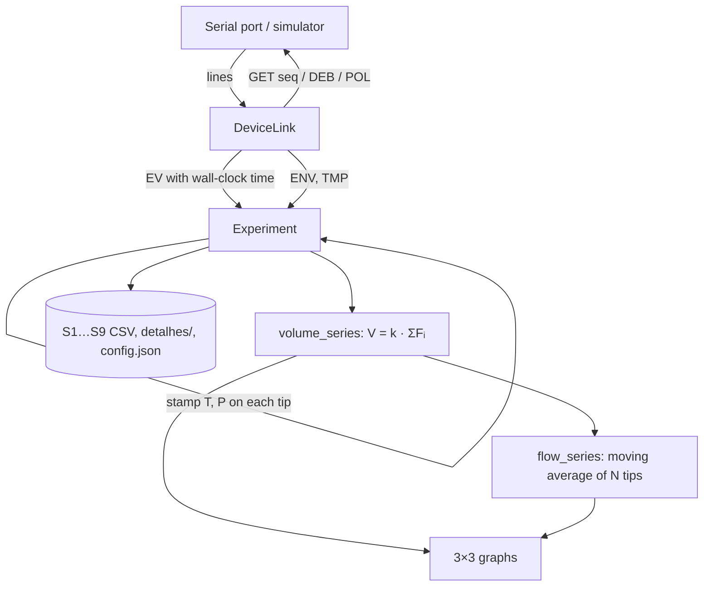

# Interface: methods

The TipGas app (`interface/`, Python 3 + PySide6 + pyqtgraph) receives raw tips from the board and computes everything else. Main modules:

| File | Role |
|---|---|
| `tipgas_core.py` | No GUI: `DeviceLink` (protocol, clock mapping, recovery), `Experiment` (data, volume, flow, correction, files), `Correction` |
| `tipgas_gui.py` | Main window, 3×3 panels, settings, status bar, event log |
| `calibration.py` | Calibration assistant for k |
| `simulator.py` | A virtual board speaking the same protocol (with line loss, disconnection and reset tests) |
| `i18n.py` | English/Portuguese strings |

## 1 · Board time → PC time

The board timestamps tips in milliseconds since its boot (`t_ms`). The app maps that to wall-clock time with an offset:

  wall = offset + t_ms / 1000

The offset is set on first contact and then refined with the **smallest** `now − t_ms/1000` observed on each `ST` message, which is the message with the least USB latency. Tip times therefore keep the board's 1 ms resolution, independent of PC load or USB delays.

## 2 · No lost or duplicated tips

- Each event has a sequence number. The app tracks the highest contiguous number received; when `ST` reports a higher `next_seq`, it requests the gap with `GET,<n>`. Duplicates (an event received live and again in a replay) are dropped by `(session, seq)`.
- On **first contact** the app asks for the whole buffer (`GET,0`); only events after the recording start time enter the experiment.
- **Board restart** (power loss, reset button) is detected when `t_ms` goes backwards, `next_seq` falls, or the mapped time disagrees with the PC clock by more than 120 s. A new *session* starts, and the restarted board's events are appended after the previous ones, so cumulative volumes continue.
- A cable unplugged during a recording only pauses the display: the serial thread reconnects automatically and the missing tips are fetched.

## 3 · Temperature and pressure of each tip

At the moment each tip arrives, the app **stamps** it with:

- **T**: the latest reading of the DS18B20 assigned to that channel (*Settings → Temperature*), if not older than 60 s; otherwise the BME280 air temperature; otherwise none;
- **P**: the latest BME280 pressure, if any;
- the **source** of T (probe code or `BME280`).

These values are saved with the tip (`detalhes/basculamentos.csv`) and are the ones used in the correction, so a saved experiment can be recomputed later with exactly the same temperatures.

## 4 · Volume

For channel c with calibration factor k (mL per tip) and correction factor Fᵢ for tip i:

  V(tₙ) = k · Σᵢ₌₁ⁿ Fᵢ  (without correction Fᵢ = 1, so V = n · k)

### Correction modes (top bar, *Correction*)

| Mode | Fᵢ |
|---|---|
| No correction | 1 |
| **Calibration conditions (T_ref, P_ref)** | (T_ref + 273.15)/(Tᵢ + 273.15) · (P_ref − P_H₂O(Tᵢ)) / (P_ref − P_H₂O(T_ref)) |
| STP, dry gas | (Pᵢ − P_H₂O(Tᵢ))/101.325 · 273.15/(Tᵢ + 273.15) |
| STP, wet gas | Pᵢ/101.325 · 273.15/(Tᵢ + 273.15) |

with temperatures in °C and pressures in kPa. Water-vapour pressure uses the **Antoine equation**:

  P_H₂O(T) [kPa] = 0.133322368 · 10^(8.07131 − 1730.63/(233.426 + T))  (≈ 3.16 kPa at 25 °C; valid 1–100 °C)

The *calibration conditions* mode follows the reference article: each tip's gas, assumed saturated with water vapour, is brought to the temperature T_ref and pressure P_ref at which k was measured. Pressure is taken as constant (= P_ref). If Tᵢ = T_ref, Fᵢ = 1; warmer gas is expanded, so Fᵢ < 1. Two remarks on the article's text, implemented here: the Antoine denominator is (D **+** T), and the corrected volume of a single tip is k · Fᵢ (n only appears in the sum).

A tip with no temperature has Fᵢ = 1, and the status bar warns when no temperature sensor is present.

## 5 · Flow

Flow is a **moving average over the last N tips** (N set in *Settings*, default 3):

  Qᵢ = (Vᵢ − Vᵢ₋ₙ) / (tᵢ − tᵢ₋ₙ)  [mL/h], plotted at the middle of the interval

Averaging over tips rather than over fixed time windows avoids the zero/spike pattern of a quantised signal at low flow. The value shown in each panel also decays when no tip arrives for longer than the recent mean interval: it is limited to k / (time since the last tip), an upper bound for the current flow.

*Data → Export table at regular intervals* samples the cumulative volume on a fixed time grid (volume counted up to each grid time) and gives the flow of each interval as ΔV/Δt, convenient for spreadsheets.

## 6 · Calibration of k

*Data → Calibrate k factors…* (or *Settings → Measurement*):

1. Tick the channels and click **Start counting**.
2. Inject a known gas volume into each cell (syringe, burette, flow controller), at a flow similar to the experiments.
3. Enter the injected volumes and click **Calculate**: k = V_injected / n, with counting uncertainty ±1/n (the last bucket may be partly filled). Use at least 20 tips (≤ 5 %).
4. **Apply to channels** copies k to each panel. Optionally, the mean temperature and pressure during calibration become T_ref and P_ref. A record is saved in `calibracoes/`.

Good practice: make the cell tip once before starting so the bucket starts in the same state; calibrate at 3–5 flows across the working range; use the same sealing liquid and level as in the experiments; repeat three times to estimate repeatability.

## 7 · Settings and what goes to the board

All user settings live on the PC in `~/.tipgas.json` (`C:\Users\<user>\.tipgas.json` on Windows), saved at every change. Only what affects **counting** is sent to the board:

| Setting | Where | Sent to board |
|---|---|---|
| Channel name, enabled, k (FC) | Panels | No |
| DS18B20 assigned to each channel | Settings → Temperature | No (the board reads all probes) |
| **Polarity** ↓/↑ | Button on each panel | **Yes**, `POL,<mask>` immediately |
| **Lockout** (default 2000 ms) | Settings → Device | **Yes**, `DEB,<ms>` 1.5 s after the last change |
| Correction, T_ref, P_ref, flow N, time unit, graph type, export interval, language | Top bar / Settings | No |

On every connection the app compares the board's `ID` (lockout and polarity stored in its flash) with its own settings and sends `DEB`/`POL` only if they differ; the board answers `OK` and saves to flash. Thus a board that restarts without the PC keeps counting with the last settings, and a new board is configured automatically on first connection.

## 8 · Simulation mode

Choose **Simulation (no board)** as the port. The simulator generates realistic gas production curves on nine channels, T/P/RH and three virtual DS18B20, at 1× to 3600× speed, and has buttons to drop USB lines, disconnect for 5 s and restart the MCU, which exercise sections 2 and 3. The automated tests (`interface/tests/test_core.py`) use the same simulator.
